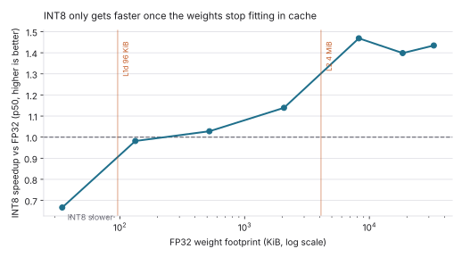
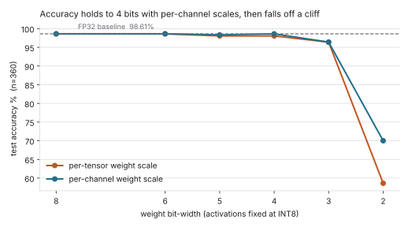

# tinyquant

**INT8 post-training quantization and an integer-only inference engine, both written from scratch — plus the benchmark that shows when quantizing is the wrong call.**

No PyTorch, no TensorFlow, no ONNX Runtime, no TFLite. The trainer is NumPy, the
quantizer is plain Python, the inference engine is dependency-free C99, and every
number below is produced by `make all` on a clean checkout.

[](https://github.com/MattyIceMatrix/tinyquant/actions/workflows/ci.yml)


---

## The result that made this worth publishing

I expected INT8 to be faster. It needed **42% more time per inference**.

| | p50 latency | accuracy |
|---|---|---|
| FP32 C kernel | **0.775 µs** | 98.61% |
| INT8 C kernel | 1.099 µs | 98.61% |

Median of 7 trials, `-O3 -march=native`, 150 repetitions over 360 samples each.

Same machine, same compiler, same flags, both kernels written by me in the same
style so the comparison is fair. The usual story — "INT8 moves a quarter of the
bytes, so it runs faster" — is true, and irrelevant here: this model's weights
are 26 KB, they sit in L1 the whole time, and nothing is waiting on memory. What
is left is arithmetic, and there the FP32 path wins, because the compiler packs
8 floats into an AVX register while my INT8 path widens every byte to int32
before accumulating and then pays for a fixed-point requantization per output.

So I tested that explanation instead of writing it up as an excuse. If the win is
really about memory, it should appear exactly when the weights stop fitting in
cache:



| FP32 weight footprint | INT8 speedup (p50) |
|---|---|
| 35 KiB — fits L1 (96 KiB) | **0.67× (slower)** |
| 522 KiB — past L1 | 1.03× |
| 2.0 MiB — inside L2 (4 MiB) | 1.14× |
| 8.0 MiB — past L2 | 1.47× |
| 32 MiB — far past L2 | 1.43× |

That is the honest shape of the result. INT8 is a **memory** optimization that
shows up as a latency win only once you are memory-bound. On a model small enough
to live in L1, quantization buys you size and the ability to run without an FPU —
not speed. Three trials per point, median reported, spread recorded in
[`artifacts/scaling_study.json`](artifacts/scaling_study.json).

---

## What INT8 does buy, measured

| | FP32 | INT8 (per-channel) |
|---|---|---|
| Test accuracy (360 held-out samples) | 98.61% | **98.61%** (−0.00pp) |
| Deployed size | 26,280 B | **7,524 B** (3.49× smaller) |
| Floating-point instructions on the inference path | required | **zero** |
| Heap allocations per inference | — | **zero** |
| Worst-case stack frame | 4,208 B | **3,200 B** |

Size counts the biases and per-channel requantization parameters, not just the
weights. Quoting 4× by ignoring everything that isn't a weight is how
quantization write-ups end up unreproducible.

---

## Accuracy: how far down can the weights go?

Activations stay at INT8; weight bit-width sweeps from 8 down to 2, with both
weight-scale granularities, on the held-out test set.



| weight bits | per-tensor scale | per-channel scale | size | compression |
|---|---|---|---|---|
| 8 | 98.61% | 98.61% | 7,524 B | 3.49× |
| 6 | 98.61% | 98.61% | 5,908 B | 4.45× |
| 5 | 98.06% | 98.33% | 5,100 B | 5.15× |
| 4 | 98.06% | **98.61%** | 4,292 B | 6.12× |
| 3 | 96.39% | 96.39% | 3,484 B | 7.54× |
| 2 | 58.61% | **70.00%** | 2,676 B | 9.82× |

Two things worth taking from this:

**Per-channel scaling earns its keep only under pressure.** At 8 bits it changes
nothing — a reviewer would be right to call it premature complexity. At 4 bits it
is the difference between lossless and −0.56pp, and at 2 bits it recovers 11.4
points. One outlier column otherwise sets the scale for the whole matrix and the
quiet columns lose their resolution.

**Calibration method barely mattered here.** min-max and 99.9th-percentile
clipping landed within a fraction of a point almost everywhere. I kept both
implemented and both measured rather than claiming a winner this model cannot
demonstrate.

---

## Why you can trust the numbers above

### The C engine is bit-exact with the Python reference

Not "close" — identical. A quantization pipeline where the trainer-side
simulation and the deployed kernel disagree is a pipeline whose accuracy numbers
describe a program nobody is running.

```
360 samples × 10 classes = 3,600 output values compared
mismatched values:        0
argmax disagreements:     0
worst absolute difference: 0
```

### …on four instruction sets, under two compilers, at five optimization levels

Every build checks the same reference bytes. Cross-architecture builds use
`zig cc` and run under `qemu-user`, so the whole matrix reproduces on an ordinary
Linux box with no special hardware.

| | verified |
|---|---|
| Architectures | x86-64, **aarch64**, **riscv64**, **arm32** (hard-float) |
| Compilers | gcc 13.3, clang |
| Optimization | `-O0 -O1 -O2 -O3 -Os` |
| Builds run | **13** |
| Distinct accuracy values observed across all 13 | **1** |

### …and on 500 randomly generated models

Fixed test sets only exercise one shape. The differential fuzzer varies depth,
width, bit-width, granularity and calibration, and deliberately includes the
cases that break INT8 pipelines: a single dominating outlier weight, all-zero
weights that would produce a zero scale, activations large enough to threaten the
int32 accumulator, and single-neuron layers where vectorized code reads off the
end. See [`artifacts/fuzz.json`](artifacts/fuzz.json).

Configurations the quantizer *refuses* — a bias that will not fit in int32, an
accumulator that would overflow — are counted and reported, not silently skipped.
A refusal is correct behaviour and hiding it would overstate the coverage.

### …with no memory errors and no allocations

`valgrind --leak-check=full --errors-for-leak-kinds=all` over the full test set:
**0 errors**. `tq_forward` references no allocator symbol at all; its working
buffers are stack arrays bounded by a compile-time width.

| `TQ_MAX_WIDTH` | `tq_forward` stack frame |
|---|---|
| 32 | 320 B |
| 64 | 512 B |
| 128 | 896 B |
| 512 | 3,200 B |

That knob is the one a firmware integrator turns, which is why it is measured
across settings rather than quoted once.

### Every number in this README is a test

[`claims.json`](claims.json) binds all 33 claims above to the artifact that produced
it. `tests/test_claims.py` re-reads the measurements and fails if any of them
moved, so CI goes red when the prose drifts from reality.

```
$ pytest tests/test_claims.py -q
34 passed
```

Accuracy and size claims are asserted exactly, because the pipeline is
deterministic. Timing claims are asserted *directionally* — an absolute
microsecond figure is a property of the machine that produced it, not of this
code, and asserting one would make the suite fail on your laptop for no good
reason.

This mechanism has already caught a real problem in its own repository: a
single-run timing protocol that was unstable enough to invert a conclusion. See
[FINDINGS.md §8](FINDINGS.md).

---

## Reproduce it

```bash
git clone https://github.com/MattyIceMatrix/tinyquant
cd tinyquant
pip install -r requirements.txt
make all          # train, quantize, cross-validate, benchmark, sweep, chart, test
```

Individual steps:

```bash
make train        # FP32 reference model (NumPy, fixed seed)
make export       # quantize + write the binary model files
make crossval     # bit-exactness: C engine vs Python reference
make bench        # INT8 vs FP32 latency percentiles
make sweep        # accuracy across bit-width × granularity × calibration
make scaling      # the cache-crossover study
make portability  # 13 builds, 4 architectures, all bit-exact
make audit        # heap, stack, valgrind
make fuzz         # randomized differential testing
make verify       # the two that matter: bit-exactness + claim checking
```

No network access is needed after `pip install`: the dataset ships inside
scikit-learn, so the numbers reproduce offline.

---

## How it works

**Quantization scheme.** Symmetric signed INT8, zero-point 0, for both weights
and activations: `real ≈ scale × q`, `q ∈ [−127, 127]`. Activation ranges come
from calibration — running FP32 inference over unlabeled samples and recording
how large each tensor actually gets.

**Integer-only requantization.** An INT8 layer accumulates into int32 and has to
come back down to int8. The scale factor for that is a real number
(`s_x · s_w / s_y`), but the target may have no FPU, and float rounding makes
bit-exactness across compilers awkward. So the multiplier is stored as a Q0.31
fixed-point integer plus a shift and applied with integer operations only
(`saturating_rounding_doubling_high_mul` + `rounding_divide_by_pot`, matching
gemmlowp/TFLite semantics). This is the single decision that makes the
four-architecture bit-exactness result possible.

**Memory layout.** Weights are stored `(in, out)` row-major so the inner loop
walks memory contiguously and the accumulator stays hot. At this size that
choice matters more than any arithmetic trick.

**Model format.** Flat, little-endian, fixed-layout, no pointers or compression:
parsing is a handful of bounds checks instead of a dependency. Truncated files
and bad magic numbers are rejected, and both cases are tested.

**No dynamic allocation.** Loading copies into a fixed arena; inference uses two
ping-pong stack buffers. The engine never calls `malloc`.

---

## Limitations

Stated plainly, because a reviewer will find them anyway and I would rather they
find them here.

- **The model is small and the task is easy.** 6,570 parameters, 8×8 digit
  images, 98.61% baseline. INT8 being lossless here is weak evidence that INT8
  is lossless generally — on this task there is a lot of headroom to lose.
- **No real edge hardware yet.** Everything ran on a cloud x86-64 vCPU. The
  ARM64, RISC-V and ARM32 results prove *correctness* on those instruction sets,
  not performance — they ran under emulation, so their timings are meaningless
  and none are quoted. A Raspberry Pi 5 and a Cortex-M board are the obvious
  next step, and until then no claim here is about real device latency.
- **Timings come from a shared cloud vCPU.** Two cores, no frequency pinning.
  Mid-range points in the scaling study showed up to 18% spread across trials;
  medians are reported and spreads are recorded. The L1-resident and
  past-L2 endpoints were stable to under 1%, which is why the conclusion rests
  on those.
- **Dense layers only.** No convolutions, no attention, no batching, no
  per-axis quantization for anything but the output dimension.
- **Activations are symmetric.** Zero-point 0 means a post-ReLU tensor only ever
  uses `[0, 127]` — one of eight bits spent representing negatives that ReLU
  already removed. Asymmetric activation quantization would recover it.
- **Little-endian only.** The model format is read directly from the file with
  no byte swapping. A big-endian target would need a loader change; it is not
  claimed to work and not tested.
- **Bit-packing is accounted for but not implemented.** Sub-8-bit sizes are
  computed as packed; the engine still holds those values in int8 containers.
  The size column is therefore what a packed deployment *would* cost, and is
  labelled as such.

---

## What I would do next

1. Run the same matrix on a Pi 5 and a Cortex-M4, and replace every emulated
   timing with a measured one.
2. Write an explicit NEON `SDOT` kernel. The scaling study says scalar INT8
   cannot beat auto-vectorized FP32 when cache-resident; dot-product
   instructions that multiply-accumulate int8 natively are the thing that
   changes that, and that claim deserves a measurement rather than a citation.
3. Add asymmetric activation quantization and measure whether the recovered bit
   matters below 4 bits.
4. Extend to convolutions, where per-channel scaling and memory layout matter
   considerably more than they do here.

---

## Measurement environment

All numbers in this README were produced on:

| | |
|---|---|
| CPU | Intel Xeon @ 2.10 GHz, 2 vCPU (L1d 96 KiB, L2 4 MiB) |
| OS | Linux 6.18, Ubuntu 24.04 |
| Compilers | gcc 13.3.0, clang, `zig cc` 0.17.1 for cross-builds |
| Python | 3.13 |
| Emulation | qemu-user-static 8.2.2 (correctness only, never timing) |

Re-run `make all` on your own machine and the accuracy, size and bit-exactness
numbers will match exactly; the timings will not, and should not.

---

## Repository layout

```
tinyquant/        quantizer, fixed-point arithmetic, model, exporters (Python)
engine/           tinyq.c/.h    dependency-free C99 inference engine
                  crossval.c    bit-exactness harness
                  bench.c       latency benchmark
scripts/          train, export, sweep, scaling study, portability matrix,
                  resource audit, differential fuzzer, chart rendering
tests/            97 tests: arithmetic, quantizer properties, engine, claims
artifacts/        every measurement, as JSON
claims.json       README claims bound to the artifacts that produced them
FINDINGS.md       hypotheses I got wrong, and the measurements that corrected me
```

---

## License

MIT — see [LICENSE](LICENSE).
